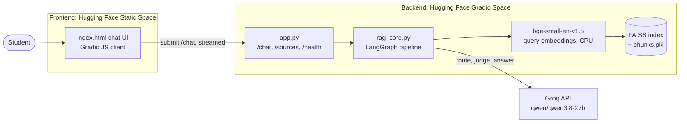
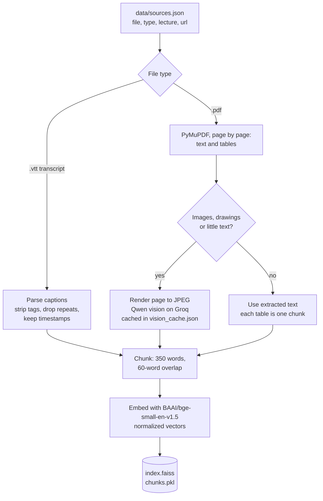
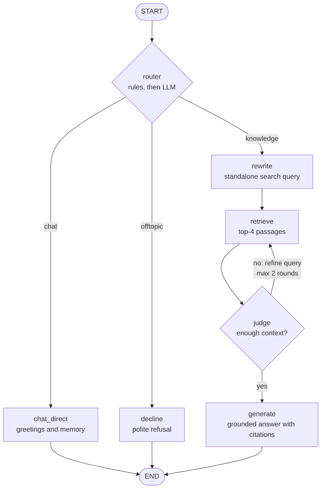
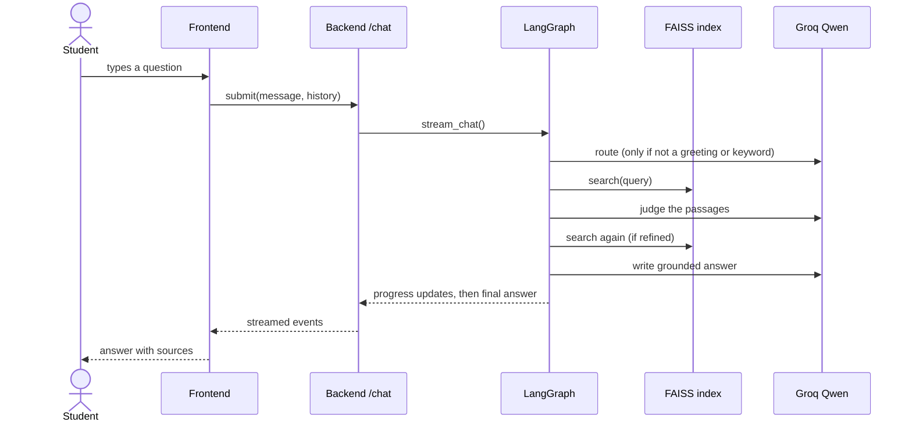

# DSA RAG: Ask the Lecture (MIT 6.046J)

A retrieval-augmented question-answering chatbot that answers **only** from one source of
truth: the MIT 6.046J *Design and Analysis of Algorithms* (Spring 2015) lecture material on
**Advanced Dynamic Programming**, taught by Erik Demaine and Srinivas Devadas.

Built for **Track 1: RAG** of the Immersive Learning challenge.

## Links

| Resource | Link |
|---|---|
| Live demo (chat frontend) |[ `<DEMO_LINK>`](https://huggingface.co/spaces/codersahil/dsa-rag-mit) |
| SRS document |[ `<SRS_LINK>`](https://drive.google.com/file/d/1fh1kMBrzNn33gFx9UV7lpR29hEoDfSFS/view?usp=drive_link) |

## What it does

- **Grounded answers.** Course questions are answered only from the retrieved lecture passages, with `[1]`, `[2]` citations that point to the lecture, source type, and timestamp or page.
- **Refuses what it can't ground.** Questions the material doesn't cover get a polite refusal instead of a guess.
- **Knows when to search.** A LangGraph router decides per message whether to use the knowledge base, chat directly (greetings, "my name is...", "what's my name?"), or decline off-topic questions.
- **Searches until it has enough.** An LLM judge checks the retrieved passages and, if they fall short, rewrites the query and searches again.
- **Understands diagrams and tables.** PDF pages with figures or handwriting are transcribed by a vision model and labelled as AI-generated.
- **Study-material archive.** A tab lists every source in the knowledge base with links and downloads.
- **Separate backend and frontend.** A Gradio API backend and a static chat page, deployed as two Hugging Face Spaces.

## Architecture



### Knowledge-base build (offline, `build_index.py`)



### Question answering (runtime, LangGraph)



### One chat request



## Knowledge base

| Source | Type | Chunks |
|---|---|---|
| Advanced Dynamic Programming lecture video (YouTube auto-captions) | transcript | 41 |
| Lecture notes (`Lecture_notes.pdf`, 7 pages) | PDF | 7 |
| Recitation (`Recitation.pdf`, 4 pages) | PDF | 7 |
| `Introduction.pdf` (43 pages) `<add title and source>` | PDF | 96 |
| **Total** | | **151** |

Pages with figures, tables or handwriting (2 of 7, 1 of 4 and 32 of 43 pages were flagged) are described by a vision model. Those chunks are labelled *AI-generated description* in the citations.

## Tech stack

| Layer | Technology |
|---|---|
| Orchestration | LangGraph (router, retrieve, judge loop, generate) |
| Embeddings | `BAAI/bge-small-en-v1.5` via sentence-transformers (CPU) |
| Vector store | FAISS `IndexFlatIP` (cosine similarity on normalized vectors) |
| LLM and vision | `qwen/qwen3.8-27b` on Groq |
| PDF and transcript parsing | PyMuPDF, custom WebVTT parser |
| Backend | Gradio (headless API) on a Hugging Face Space |
| Frontend | Static HTML/JS, `@gradio/client`, marked, DOMPurify |

## Repository structure

```
dsa-rag/
├── backend/
│   ├── app.py              API server: /chat (streamed), /sources, /health
│   ├── rag_core.py         LangGraph pipeline (router, retrieve, judge, generate)
│   ├── build_index.py      builds index.faiss and chunks.pkl from data/
│   ├── requirements.txt
│   ├── README.md           Hugging Face Space config (sdk: gradio)
│   ├── index.faiss
│   ├── chunks.pkl
│   └── data/
│       ├── sources.json    catalogue of every source (drives citations and the archive)
│       ├── transcripts/
│       ├── pdfs/
│       ├── pages/          page images rendered for vision
│       └── vision_cache.json
├── frontend/
│   ├── index.html          chat UI
│   └── README.md           Hugging Face Space config (sdk: static)
└── docs/
    ├── README.md           this file
    └── SRS.md              software requirements specification
```

## Run it locally

Requirements: Python 3.10 or newer and a [Groq API key](https://console.groq.com).

```bash
# 1. backend
cd backend
python -m venv venv && source venv/bin/activate     # Windows: venv\Scripts\activate
pip install -r requirements.txt pymupdf             # pymupdf is only needed to build the index
export GROQ_API_KEY="your-key"                      # Windows PowerShell: $env:GROQ_API_KEY = "your-key"

# 2. (optional) rebuild the knowledge base after changing data/
python build_index.py --vision

# 3. start the API
python app.py                                       # http://127.0.0.1:7860

# 4. frontend, in a second terminal
cd frontend
python -m http.server 8000
# open http://localhost:8000/?backend=http://127.0.0.1:7860
```

Never commit your API key. On Hugging Face, store it as a Space secret.

## Deploy on Hugging Face

1. **Backend:** create a Gradio Space and upload the contents of `backend/` (without `build_index.py` and `venv`). Add the secret `GROQ_API_KEY` under *Settings, Variables and secrets*.
2. **Frontend:** create a **Static** Space and upload `frontend/index.html` and `frontend/README.md`. If your backend Space has a different name, change `BACKEND` near the top of the script in `index.html`.
3. Free accounts run Gradio Spaces on ZeroGPU. `app.py` includes a harmless `@spaces.GPU` placeholder so the Space starts. The app itself runs on CPU.

## API reference

The backend is a Gradio app, so it is called with the Gradio client.

| Endpoint | Input | Output |
|---|---|---|
| `/chat` | `message` (text), `history_json` (JSON list of `{role, content}`) | stream of `{"done": false, "status": "..."}`, then `{"done": true, "route": "knowledge \| chat \| offtopic", "answer": "<markdown>"}` |
| `/sources` | none | list of `{lecture, type, file, url, download}` |
| `/health` | none | `{status, chunks, model, has_llm_key}` |

```python
from gradio_client import Client

client = Client("<owner>/<backend-space>")
for event in client.submit("What is memoization?", "[]", api_name="/chat"):
    print(event)
```

## Configuration

| Variable | Default | Purpose |
|---|---|---|
| `GROQ_API_KEY` | none (required) | LLM and vision calls |
| `ANSWER_MODEL` | `qwen/qwen3.8-27b` | Groq model for routing, judging and answers |
| `VISION_MODEL` | `qwen/qwen3.8-27b` | Groq model for page descriptions (build time) |
| `MAX_LOOPS` | `2` | Search and judge rounds per question (set `1` to disable the loop) |
| `MIN_SCORE` | `0.25` | Minimum best-match score before the LLM is called |
| `VISION_MAX_SIDE` | `1000` | Longest side in pixels of page images sent to the vision model |
| `VISION_PAUSE` | `12` | Seconds to wait between vision calls (free-tier limits) |

## Evaluation

Fill in the *Result* column after running each question against the live demo.

| # | Message | Expected behaviour | Result |
|---|---|---|---|
| 1 | `hello` | Friendly greeting, no sources | `pass` |
| 2 | `My name is Sahil` | Friendly reply, no search, no sources |`pass` |
| 3 | `What is my name?` | Answers from the conversation | `pass`|
| 4 | `What is memoization?` | Grounded answer with citations |`pass`|
| 5 | `What is the difference between top-down and bottom-up DP?` | Grounded answer with citations | `pass`|
| 6 | `Explain that again with an example` | Uses the previous topic, grounded answer |`pass` |
| 7 | A question about a table or figure in the notes | Answer cites an AI-generated description |`pass` |
| 8 | `What is the capital of France?` | Polite decline | `pass` |
| 9 | `Tell me a joke` | Polite decline | `pass` |
| 10 | A course-related question the material doesn't cover | Refuses to answer | `pass` |

## Known limitations

- **Free-tier limits.** Groq's free tier has tight token limits, and the model is labelled *Preview*. Several simultaneous users may see the retrieval-only fallback.
- **Transcript quality.** The transcript is YouTube auto-captions, which can contain misspellings.
- **Vision descriptions can be wrong.** Numbers in tables deserve a check against the original page.
- **Refusal threshold.** `bge-small` scores are compressed (even unrelated text scores around 0.5), so the score gate is weak. The citation rule does most of the refusing.
- **Mixed messages.** A message mixing small talk and a course keyword goes to the knowledge base.
- **Narrow scope.** The knowledge base covers one lecture topic plus its supporting PDFs.

## Credits and licence

- Course material: MIT OpenCourseWare, *6.046J Design and Analysis of Algorithms*, Spring 2015, Erik Demaine and Srinivas Devadas. Licensed [CC BY-NC-SA 4.0](https://creativecommons.org/licenses/by-nc-sa/4.0/). [Course page](https://ocw.mit.edu/courses/6-046j-design-and-analysis-of-algorithms-spring-2015/).
- Lecture video: MIT OpenCourseWare on YouTube.
- Code licence: `<CHOOSE_A_LICENSE>`.
- Author: `Sahil Goyal`, `TIET'28`.
